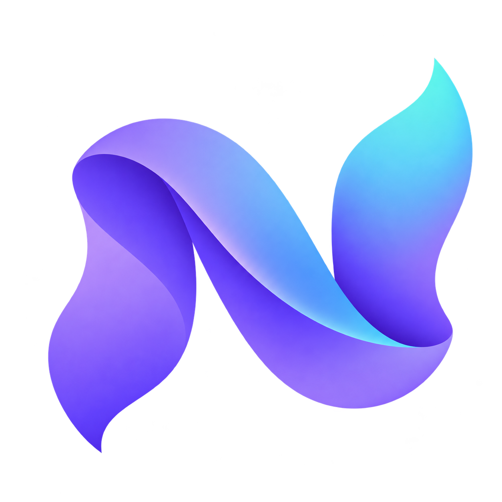
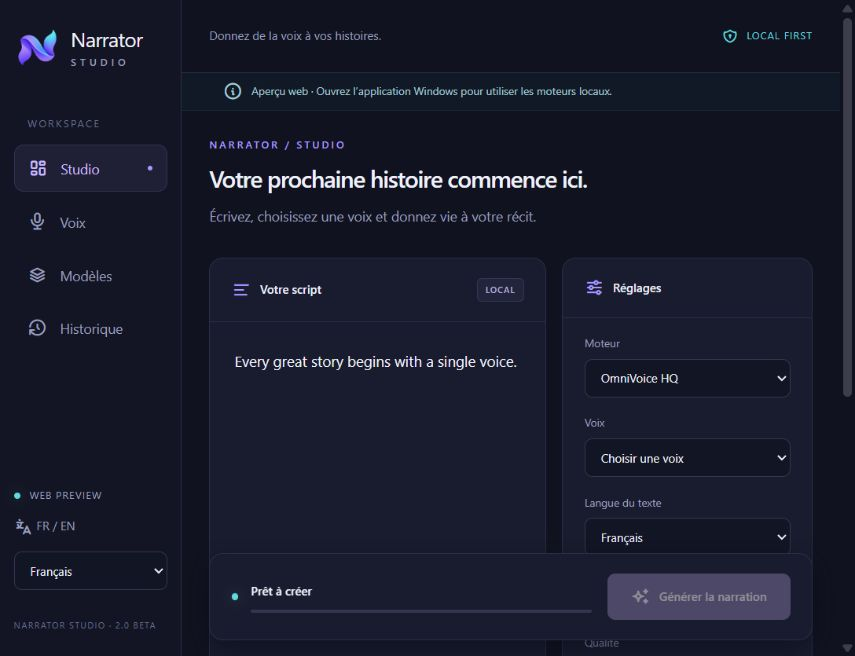

<div align="center">



# Narrator Studio

### Your words. Your voice. Your studio.

Create narrations with local AI voices, voice cloning and automatic quality checks.<br>
A focused desktop workspace for turning scripts into stories.

[](docs/installation.md)
[](https://github.com/HeyCherif/narrator-studio-storydub/releases/tag/v2.0.0-beta.1)
[](src-tauri)
[](#your-workspace)

**[Download for Windows](https://github.com/HeyCherif/narrator-studio-storydub/releases/download/v2.0.0-beta.1/NarratorStudio-2.0.0-beta.1-Windows-setup.exe)**
&nbsp; · &nbsp;
[Portable edition](https://github.com/HeyCherif/narrator-studio-storydub/releases/download/v2.0.0-beta.1/NarratorStudio-2.0.0-beta.1-Windows-portable.zip)
&nbsp; · &nbsp;
[Installation guide 🇫🇷](docs/installation.md)

</div>

<br>



<p align="center"><sub>The real frontend in web preview mode. Local synthesis runs in the Windows application.</sub></p>

---

## Make room for the story

Write your script, pick a voice and generate your narration. Narrator Studio brings the writing space, voice library, model manager and audio history into one dark desktop interface.

Synthesis runs on your computer through your existing **OmniVoice** and **Qwen3-TTS** Python environments. **Faster-Whisper** checks pronunciation against your script, alongside acoustic checks and targeted retries.

## Your workspace

| Space | What you can do |
| :--- | :--- |
| **Studio** | Write or paste a script, choose a voice and language, generate, listen and export. Your draft survives navigation. |
| **Voices** | Browse existing profiles and create a Qwen voice from a reference clip with automatic transcription. |
| **Models** | Reuse installed engines and models, or download the official Qwen Base model with pause, resume and integrity checks. |
| **History** | Find previous narrations, play them and export audio. Missing files stay visible in the library. |

### Built for longer narrations

- **Smart text splitting** — turn long scripts into manageable passages.
- **Audio checks** — inspect generated WAV files and compare transcriptions with the intended text.
- **Targeted recovery** — retry difficult passages and split them further when needed.
- **Final assembly** — combine validated segments into the finished narration.
- **Local library** — keep models, voices and audio at their existing locations.
- **Two interface languages** — switch between French and English.

## Start creating

### 1 · Get the app

Download the **[Windows installer](https://github.com/HeyCherif/narrator-studio-storydub/releases/tag/v2.0.0-beta.1)** or extract the portable edition. Close any older instance before opening the new one.

> **This is a beta for Windows 10/11 x64.** Microsoft WebView2 is required. The app is not digitally signed. AI runtimes and model weights are external and are not included in the download.

### 2 · Bring your existing library

Open **Models → Use my existing installation** and select your existing Narrator Studio folder. Small configuration and history indexes are backed up; models and audio stay in place.

If an engine is not detected, open **Advanced configuration** and select its Python interpreter and model folder. Whisper is required to transcribe references for Qwen cloning.

### 3 · Give it a voice

Open **Studio**, choose your engine and voice, add your text and generate. Your completed narration can be played in the app or exported through the Windows file picker.

**Need the detailed setup? → [Read the installation guide](docs/installation.md)**

## Engines & model support

| Component | Role | Setup |
| :--- | :--- | :--- |
| **OmniVoice HQ** | Narration | Reuse a compatible local Python environment, model and voice profiles. |
| **Qwen3-TTS · 0.6B Base** | Narration and voice cloning | Reuse a native snapshot or download `Qwen/Qwen3-TTS-12Hz-0.6B-Base` from its official source. |
| **Faster-Whisper** | Reference transcription and quality checks | Reuse a compatible local environment and model. |

The Rust download manager pins the model revision, verifies file integrity and preserves reusable partial downloads. A GGUF-only pack does not replace the native Qwen snapshot expected by the current Python engine.

## Your library stays yours

Personal configuration, cloned voices, reference audio, model weights and narration history are **not included in this repository or in the release packages**.

Library adoption backs up the small indexes. A library lock prevents simultaneous writes by compatible Narrator instances. The original PyWebView launcher is retained as a fallback; close one interface before opening the other on the same library.

## Under the hood

| Layer | Technology |
| :--- | :--- |
| Desktop shell & downloads | **Tauri 2 · Rust** |
| Interface | **TypeScript · Tabler · Vite** |
| Synthesis & quality checks | **Existing Python AI runtimes** |
| Desktop communication | **Private JSON-lines bridge** |

<details>
<summary><strong>Build the Windows application</strong></summary>

Requires Node.js 24, Python 3.12 with PyInstaller 6.16, Rust stable and Microsoft C++ Build Tools.

```powershell
npm ci --prefix desktop
python -m unittest discover -s tests -v
npm test --prefix desktop
npm run build --prefix desktop
python scripts/build_bridge.py
python scripts/collect_notices.py
desktop/node_modules/.bin/tauri build --features desktop --bundles nsis
```

The repository also includes a Windows GitHub Actions workflow. See the [installation and build guide](docs/installation.md).

</details>

<details>
<summary><strong>Run the original Python interface</strong></summary>

```powershell
python -m venv .venv
.\.venv\Scripts\Activate.ps1
pip install -r requirements.txt
python app.py
```

On Windows, `LANCER_NARRATOR_STUDIO.bat` is also available. `SELF_TEST.py` checks the existing narration pipeline.

</details>

## Release verification

The 2.0 beta was checked with **23 Python tests, 14 Rust tests and 10 interface tests**, plus a Windows build and a compatibility check between separate Python versions.

Real **OmniVoice narration**, **Qwen voice cloning** and **Qwen narration** were exercised locally. Both narration engines were also tested through the packaged bridge. Release assets include SHA256 checksums and third-party notices.

[Verification report](docs/verification-2.0-beta.1.md) &nbsp; · &nbsp; [Release notes & known limits](docs/release.md) &nbsp; · &nbsp; [Windows builds](https://github.com/HeyCherif/narrator-studio-storydub/actions/workflows/desktop.yml)

---

<div align="center">

**Narrator Studio · StoryDub**<br>
<sub>Give your next story a voice. Built by <a href="https://github.com/HeyCherif">HeyCherif</a>.</sub>

</div>
